# Sysadmin Log: Authentik Deployment with Traefik and LDAP

**Date:** 2026-10-01

**Report Time:** 14:06

**Category:** Architecture

**Status:** In Progress

---

## 1. Context & Problem Statement

**One-line summary:** Deploy Authentik as the central login system (SSO) for the homelab, pairing it with Traefik to offer secure OpenIDConnect SSO, as well as trusted TLS certificates for LDAP-based authentication.

**Background:** After deploying Traefik [2026-08-02], the next step was to centralize authentication. Before this, each service used its own authentication system, plenty of which were based on environment variables. This means security is highly variable and account sprawl becomes a concern as the number of services grows.

## 2. Architectural Decisions & Strategy

### Decision 1: Authentik as the central login provider

**Decision:** Use Authentik instead of Keycloak or Authelia.

**Rationale:**
- Authelia is lightweight, but it has fewer options for customizing login flows, and weaker MFA enrollment management.
- Keycloak is fully featured, but it needs a lot of memory (Java) and is more work to run than this homelab needs.
- Authentik sits in the middle. It has a built-in LDAP outpost, flexible login flows, and works with Traefik.

- Authentik and Traefik work well together by combining proxy authentication with Traefik's proxy middleware.

### Decision 2: Route web and LDAPS traffic through Traefik

**Decision:** Send web traffic through Traefik's HTTP routers on the shared `proxy_web` network. Send LDAPS (port 636) through a Traefik TCP router.

**Rationale:** Keeping Traefik as the single entry point means one place to manage access. The internal `authentik` network (used for the database and for server-to-outpost traffic) stays isolated from other containers.

### Decision 3: Run the LDAP outpost as part of the Docker Compose Stack.

**Decision:** Run the LDAP outpost as a normal container in the Authentik compose file, and remove all Docker socket access from the Authentik stack. No socket mount and no socket proxy.

**Rationale:**

- Authentik only needs Docker access to create and manage outposts automatically. By manually creating a dedicated LDAP outpost, we remove the need to mount the Docker socket and limit the privileges required to run Authentik.

- Even through a socket proxy, a service that can create containers can effectively control the host. Not having that access at all is a stronger result.

- The existing socket proxy is read-only (`POST=0`), which is correct for Traefik but blocks the actions Authentik needs. Loosening it would give Traefik write access it does not need. A second proxy for Authentik would still carry the risk above.

- Labels, networks, and the image version now live in the compose file with the rest of the stack. Everything is in one place for debugging.

**Trade-offs accepted:**

- The outpost token must be set manually

- Maintaining compatibility between the Outpost and server versions becomes an operator responsibility, rather than being handled by Authentik behind the scenes. This is somewhat mitigated by the current model where Dockhand centralizes container updates.

### Decision 4: Import wildcard certificate into Authentik rather than deploy an internal CA

**Decision:** Importing the wildcard certificate into Authentik to allow for LDAPS communication without necessitating an internal CA. To this effect, Traefik does not terminate TLS for LDAPS. It passes the encrypted connection straight through to the outpost's TLS port. The outpost presents the Let's Encrypt certificate itself.

**Rationale:** The outpost handles LDAP over TLS on its own port. If Traefik terminated TLS first, the outpost would still need to speak plain LDAP behind it. Passthrough keeps the setup simple. This is a good balance between security and simplicity, while allowing for future expansion without having to handle CA root certificate installation in every new service.

### Decision 5: Keep MFA for web logins, skip it for LDAP

**Decision:** Use a separate bind flow for LDAP that has no MFA stage. OIDC and web logins keep TOTP.

**Rationale:** An LDAP bind is a single request with a username and password. There is no second step where the server can ask for a code. Authentik can accept `password;code` for human users, but service accounts that bind repeatedly cannot supply a fresh code every 30 seconds.

**Risk and how it is reduced:**
- The LDAP password is now the only factor, so service accounts use long random passwords.
- Access to LDAP is limited in layers (see Decision 6).
- Repeated failed binds are penalized by Authentik's reputation system.
- Management services, such as OPNsense, will be gated behind two layers of authentication to address this risk: a `forwardAuth` proxy (which uses the MFA-enabled flow) to protect access to the OPNsense interface and then LDAP credentials without MFA for the OPNsense authentication flow.

### Decision 6: LDAPS only, with layered access control

**Decision:** Remove plain LDAP (port 389) completely. Clients must use LDAPS on port 636. Restrict who can connect with a Traefik TCP allowlist.

**Rationale:**

- The outpost accepts plain LDAP and STARTTLS on the same port. Research suggests Authentik has no setting to *require* STARTTLS, and Traefik cannot enforce it either, because it only forwards bytes. Only the client decides whether to encrypt, so a misconfigured client could send a password in cleartext.
- Both clients (OPNsense, Jellyfin) can use LDAPS. Closing the port is simpler and safer than trying to enforce STARTTLS, and keeping authentication to one protocol reduces the attack surface.

**Layers between a client and the LDAP outpost:**

1. Only certain VLANs can reach the Traefik host at all (VLAN separation and firewall rules).

2. Traefik's TCP allowlist (`trusted-ldap`) accepts only listed source addresses.

3. The client must present valid bind credentials, and the bind flow applies Authentik's policies.

The Authentik containers have no address reachable from other VLANs. The only entry point is Traefik's published port.


### Decision 7: Replace MacVTap workarounds with Open vSwitch VLAN trunking for VM ingress

**Decision:** Migrate the hypervisor VM network attachments from MacVTap interfaces to an Open vSwitch (OVS) bridge fed by an 802.1q trunk directly from OPNsense.

**Rationale:**

- **Eliminates MacVTap host-guest isolation:** MacVTap operates directly on the physical NIC driver, intentionally blocking Layer 2 traffic between the guest VM and the host OS. Previously, this required isolated network definitions and `socat` port-forwarding proxies (as used in the Traefik deployment) to allow VM communication to host-bound containers.

- **Native VLAN handling:** Open vSwitch integrates directly with libvirt, allowing guest VMs to be tagged into specific VLANs natively in their domain XML without needing per-VLAN Linux host bridges or host IP assignments.

- **Preserves existing OPNsense architecture:** OPNsense already maintained software bridges for the required networks (`bridge0` for LAN, `bridge1` for AD/Services). Adding a dedicated physical trunk port carrying tagged sub-interfaces to these existing bridges provides the hypervisor with full network segmentation over a single physical link without adding new routing domains.

---

## 3. Implementation & Execution

### Phase I: Core Infrastructure & Networking

Generated the database password and Authentik secret key, following the official documentation.

```bash
# Generate database password and Authentik secret key
echo "PG_PASS=$(openssl rand -base64 36 | tr -d '\n')" >> .env
echo "AUTHENTIK_SECRET_KEY=$(openssl rand -base64 60 | tr -d '\n')" >> .env
# Enable error reporting
echo "AUTHENTIK_ERROR_REPORTING__ENABLED=true" >> .env

```

**Eliminating MacVTap via Open vSwitch Trunking**

To avoid bridge loops and preserve VLAN separation, the raw physical port (`igb1` / `opnsense-trunk`) was **not** added directly to the bridges. Instead, tagged sub-interfaces were created and joined to the respective existing bridges:

* Created VLAN sub-interfaces on `igb1` matching the target VLAN IDs.

* Assigned and enabled the VLAN interfaces with IPv4/IPv6 set to **None**.

* Added the corresponding VLAN interface as a member to each existing bridge (`bridge0` for LAN, `bridge1` for AD).

On the baremetal KVM host, NetworkManager was used to build a persistent Open vSwitch bridge structure bound to the physical trunk NIC.

```bash
# Create the OVS bridge
nmcli connection add type ovs-bridge conn.interface ovs-br0 con-name ovs-br0

# Attach the physical NIC to the OVS bridge via an OVS port
nmcli connection add type ovs-port conn.interface port-trunk master ovs-br0 con-name ovs-port-trunk
nmcli connection add type ethernet conn.interface <PHYSICAL_NIC> master port-trunk con-name opnsense-trunk

# Create the local OVS internal interface so libvirt can query MTU
nmcli connection add type ovs-port conn.interface ovs-br0 master ovs-br0 con-name ovs-port-br0
nmcli connection add type ovs-interface conn.interface ovs-br0 master ovs-port-br0 con-name ovs-if-br0

# Disable L3 IP management across all OVS connection profiles to prevent activation timeouts
nmcli connection modify ovs-br0 ipv4.method disabled ipv6.method disabled
nmcli connection modify opnsense-trunk ipv4.method disabled ipv6.method disabled
nmcli connection modify ovs-if-br0 ipv4.method disabled ipv6.method disabled

# Bring up the stack
nmcli connection up ovs-br0
nmcli connection up ovs-if-br0
nmcli connection up opnsense-trunk
# Validate configuration
nmcli connection show

```

VM domain configurations were updated to replace the MacVTap interface with the OVS bridge and assign the appropriate 802.1q tag.

```xml
<interface type='bridge'>
  <source bridge='ovs-br0'/>
  <virtualport type='openvswitch'/>
  <vlan>
    <tag id='<{VLAN_ID}>'/>
  </vlan>
  <model type='virtio'/>
</interface>

```

With the MacVTap network isolation resolved natively via Open vSwitch, the temporary `socat` port-forwarding proxies were permanently decommissioned from the Traefik host.

```bash
sudo systemctl disable --now ha-kvm-proxy.service
sudo rm /etc/systemd/system/ha-kvm-proxy.service
```

### Phase II: Traefik Ingress & Certificate Management

**Compose Configuration**

The compose file uses two networks:

* `authentik` (internal): PostgreSQL, server, worker, and the LDAP outpost.

* `proxy_web` (external, shared with Traefik): the server and the LDAP outpost.

The Traefik compose file was updated to add the LDAPS port to the `ports:` list, as Traefik's access log does not record TCP connections and unmapped ports fail quietly:

```yaml
    ports:
      - "80:80"
      - "443:443"
      - "636:636"
```

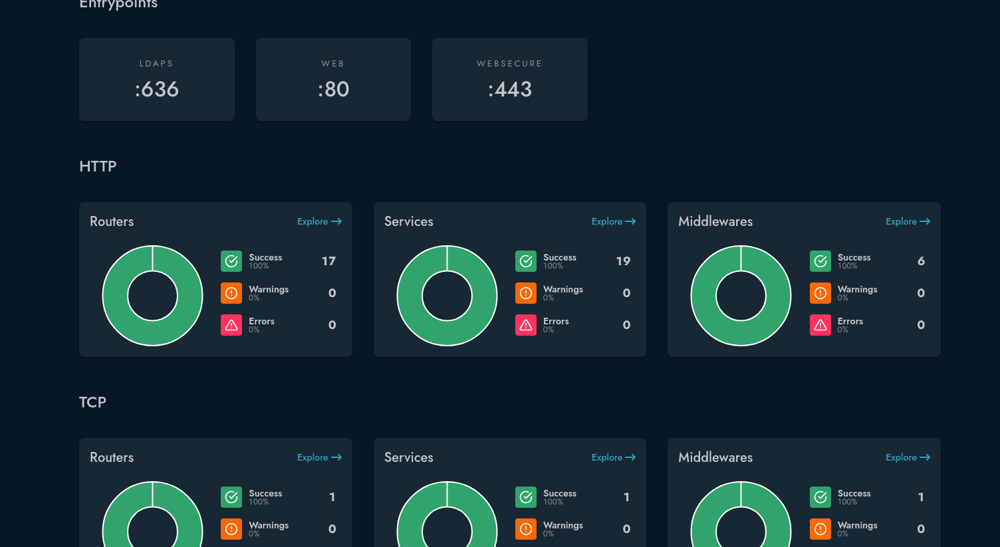

**Automatic Certificate Renewal**

* Added `traefik-certs-dumper` to the Traefik compose file. It watches `acme.json` and writes `fullchain.pem` and `privkey.pem` into a folder per domain whenever Traefik renews.

* That folder is the same host directory the Authentik worker mounts at `/certs`. Authentik finds certificates in this folder by itself and shows them under System → Certificates.

* The dumper runs as root, because it has to read `acme.json`. It sets the owner of the files it writes with `OVERRIDE_UID` and `OVERRIDE_GID`, set to the worker's user (1000). This lets the worker read the keys without being root.

**TCP Allowlist for LDAPS**

A separate TCP middleware was defined in Traefik's dynamic configuration and attached to the LDAPS router by label:

```yaml
tcp:
  middlewares:
    trusted-ldap:
      ipAllowList:
        sourceRange:
          - '{{ env "LAN_VLAN" }}'
          - '{{ env "JELLYFIN" }}'
          - '{{ env "CLOUDFLARE_TUNNEL" }}'
```

The Cloudflare tunnel was added to the list to enable LDAP authentication outside the LAN: LDAP queries made from an application accessed externally present the Cloudflare tunnel as the source, instead of the application, requiring the middleware definition include the Cloudflare tunnel in its `ipAllowList`. Given only LDAPS is enabled, the added risk of direct external LDAP access was accepted.

**Forward Authentication Middleware**

A `forwardAuth` middleware was defined in Traefik's dynamic configuration (`authentik.yml`) to protect applications lacking native authentication. The middleware points to authentik via the internal docker network and is configured to pass authorization headers to the proxied application (`X-authentik-username`, `X-authentik-groups`, `X-authentik-email`, etc.).

### Phase III: Authentik Deployment & Outpost Hardening

**Replacing the Managed Outpost**

* Authentik had created its own outposts. I deleted the embedded outpost, set the dedicated outpost's **Integration** to none, and removed the leftover managed container.


* The first outpost container would not start because `AUTHENTIK_TOKEN` was empty. The cause was a misnamed variable in `.env` (the compose file reads `AUTHENTIK_OUTPOST_TOKEN`).


* Permission errors on the outpost API were solved by using the token of the service account Authentik created automatically for the outpost, not a personal API token.

**Network Routing bypass**

The outpost failed with `undefined response type` while fetching its configuration because it was calling `https://authentik.<domain>` through Traefik, and the `trusted-services@file` IP allowlist rejected it. Both containers share the `authentik` network, so the outpost now connects directly to `http://authentik-server:9000`. This skips Traefik and the allowlist, and avoids a round trip through DNS.

**Hardening**

* **Worker no root, no socket:** The Authentik image runs as UID 1000 by default. The root came from the `user: root` line in the compose file, which the Docker integration needs. With a dedicated outpost the integration is unused, so the line and the socket mount were removed. Permissions on `/data`, `/certs`, and `/templates` were checked from inside the container, proving the directory was usable by UID 1000.

* **Outpost no database password:** `POSTGRES_PASSWORD` was removed from the outpost. It does not use it, and it would hand the database password to a container that faces LDAP traffic.

* **Plain LDAP removed:** To close port 389, the `authentik-ldap` router and service labels were removed from the outpost, alongside the `--entrypoints.ldap.address=:389` flag, the `389` port mapping, and the firewall rule for 389.

**Performance Improvements**

Following the successful validation of the LDAP routing and integration, performance tuning was applied to the LDAP outpost. The provider configuration was updated to enable both **Cached binding** and **Cached querying**. This configuration caches user and group structures in-memory, refreshing every 5 minutes, which successfully reduced authentication latency by approximately 3 seconds per login event.

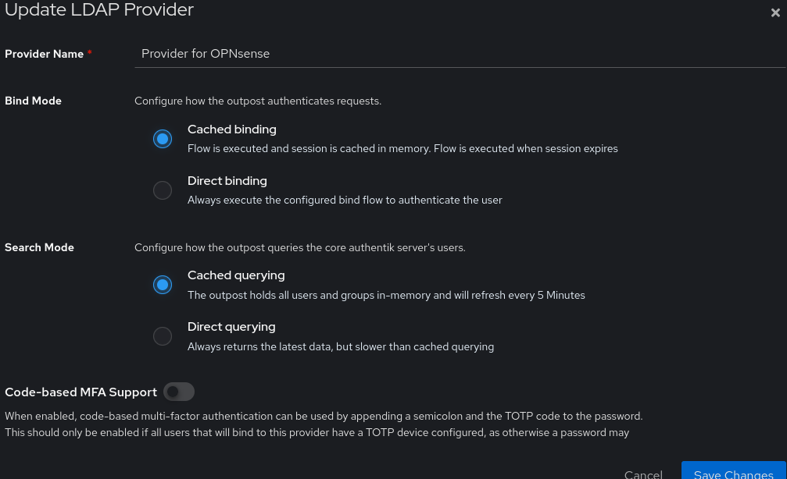

### Phase IV: LDAP Configuration & Certificate Chains

**LDAPS Certificate Troubleshooting**

LDAP clients kept receiving a self-signed certificate instead of the Let's Encrypt one. There were two separate problems:

* **Problem 1:** The outpost was using its built-in fallback certificate due to incorrect manual importing, which prevented the certificate root from being validated. Fix: re-import the certificate correctly and restart the outpost.


* **Problem 2:** The outpost served only the leaf certificate, causing clients to fail with `unable to get local issuer certificate`. Fix: import the **full chain** (leaf first, then the intermediate) as the certificate, and the private key in the separate key field.

**LDAP Provider and Bind Setup**

* **Provider:** one LDAP provider per application, each with its own Base DN, so applications only see their own data.

* **Bind mode:** direct bind first, cached after validation.

* **Bind flow:** a separate flow with no MFA stage, set on the LDAP provider only.

* **Service account:** `ldapservice` was given the **Search full LDAP directory** permission on the provider. Without it, searches only return the user's own entry, resulting in `User DN not found` errors.

**Errors seen along the way:**

| Error | Cause | Fix |
| --- | --- | --- |
| `No provider found for request` | Bind DN did not end with the provider's Base DN | Fix the DN |
| `Invalid credentials (49)` | The bind flow included MFA | Use a flow without MFA |
| `Insufficient access (50)` | Access check failed after login | Resolved after switching to direct bind mode |

### Phase V: Application Integrations

#### Summary

---

* Apps that support OIDC use Authentik as their login provider (HomeAssistant, Dockhand, etc.).

* Apps with no login can be protected by a login flow built with Authentik and Traefik (IT-Tools, Traefik Dashboard, etc.).

* Apps that only support LDAP log in through an Authentik LDAP outpost (OPNsense, Jellyfin, etc.).

* OPNsense is protected behind a `forwardAuth` Proxy on top of LDAP in order to make MFA a requirement.

* Apps with no support for LDAP or OIDC have authentication completely disabled, and safely replaced by the Traefik `forwardAuth` Proxy.

---

#### Forward Auth

**IT Tools:**

To test the `forwardAuth` middleware, IT Tools was selected as it does not support native authentication. A new application was created in Authentik, assigned to a proxy provider, which prompted the creation of a new provider. This provider was then bound to the default Authentik outpost.

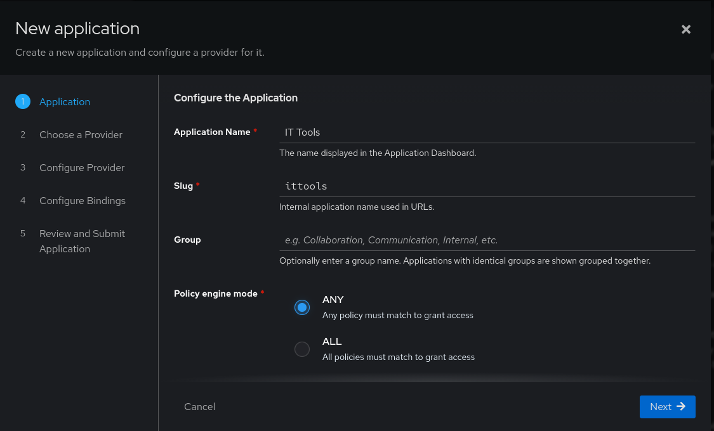

The compose file for IT Tools was updated to include the Traefik middleware `authentik@file`, which ensures only authorized and authenticated users can be connected to the application. This was then tested, which validated both the requirement for authentication and its success.

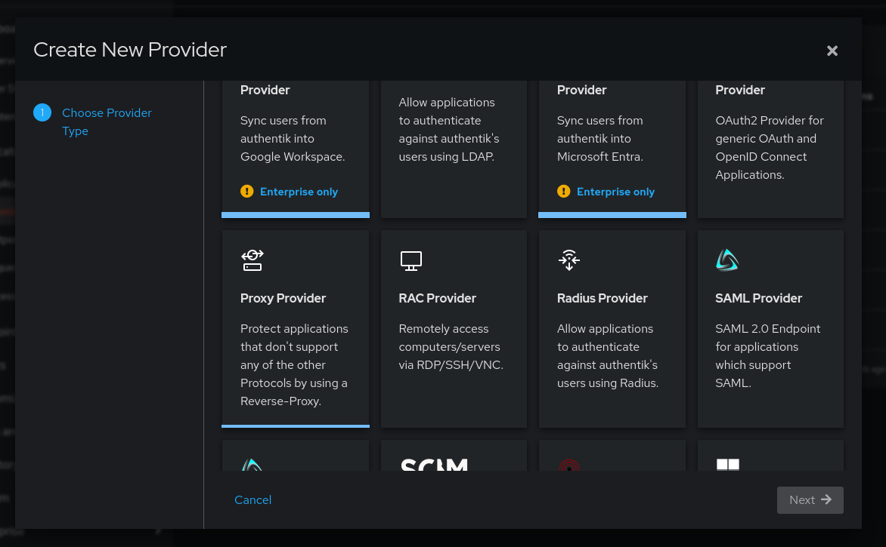

The `forwardAuth` proxy was validated once IT-Tools redirected to an authorization screen.

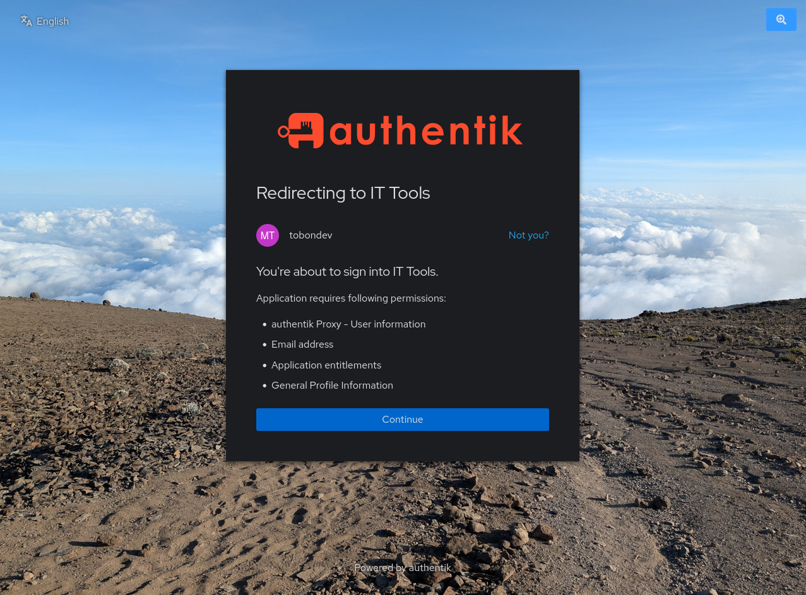

**Traefik Dashboard:**

Following this initial test, the same method was used to secure the Traefik dashboard by adding the `secure-only@file` and `authentik@file` middlewares to the Traefik compose file. On the backend for Authentik, the Traefik application was bound to the Management group, thus restricting access to regular users.

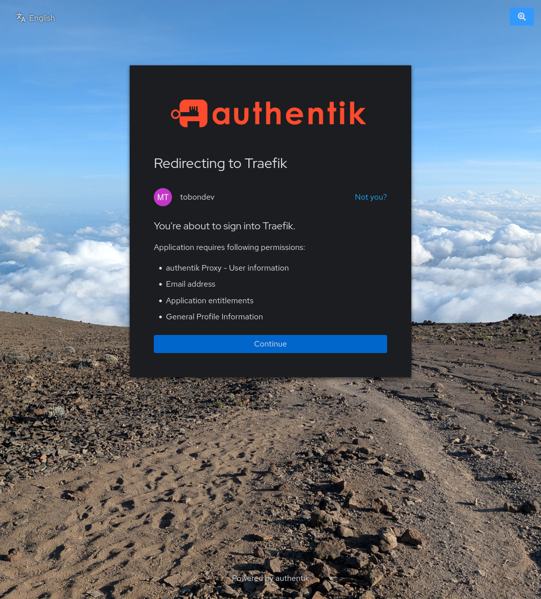

#### LDAP

As previously decided, LDAPS was routed through Traefik using a tls passthrough, and giving Authentik access to the wildcard certificates.

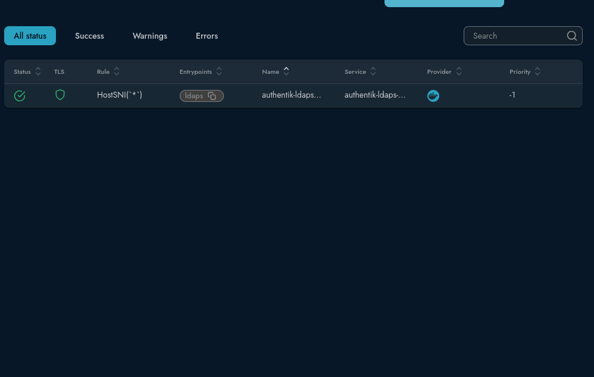

An LDAP Outpost was then manually created, and services were added to it.

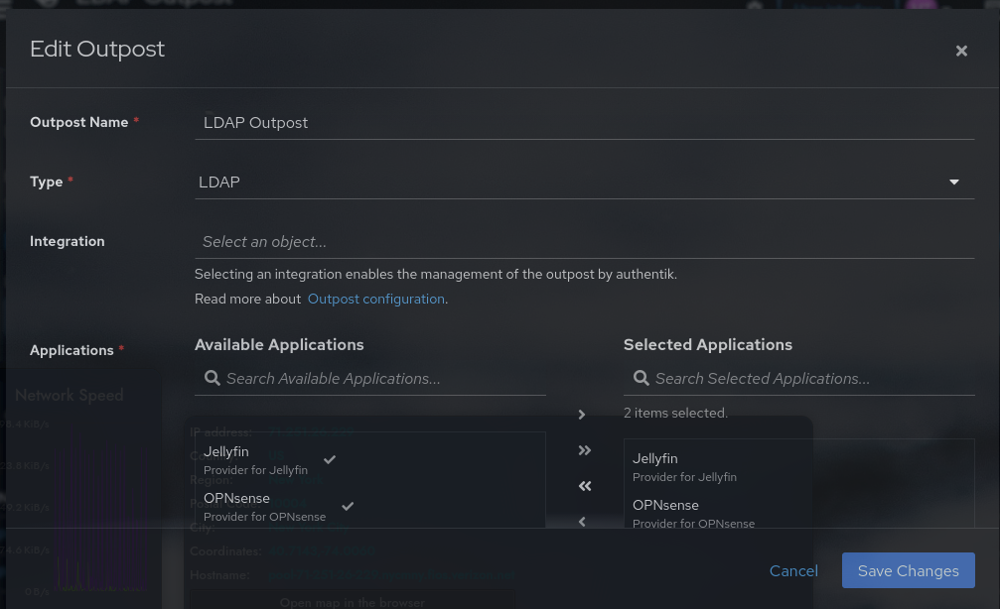

**OPNsense:**

An `ldapservice` account was created and granted directory read access, and used for the bind credentials on the OPNsense LDAP configuration. OPNsense was routed through Traefik using an `insecureSkipVerify` middleware to accommodate its self-signed web interface certificate. This routing immediately triggered a DNS Rebind attack warning on the firewall. The warning was resolved by adding `opnsense.${DOMAIN}` as an alternate hostname in the OPNsense administrative settings. This solution is specific, only granting one exception to the policy. OPNsense controls the DNS override pointing that domain to the Traefik host, making a rebind attack highly unlikely for two reasons:

- It would require prior compromise of OPNsense, Traefik or the Traefik Host, at which point the DNS override is not the highest concern.
- A successful rebind attack would have to hijack the TLS certificates to avoid security warnings, which is a much more concerning breach.

The OPNsense application was bound to the management group, restricting access to all other users. In addition to LDAP authentication, a `forwardAuth` proxy was added to further protect the application. This was done by adding the `authentik` middleware to the dynamic configuration file for OPNsense (`opnsense.yml`), which effectively adds MFA protection at the cost of an additional login screen.


On the Authentik admin interface, the OPNsense Application was bound primarily to the Proxy Provider, and the LDAP provider was added as a Backend provider. This combination had the desired effect of putting the login interface behind the proxy, while allowing OPNsense to perform LDAP queries to Authentik.


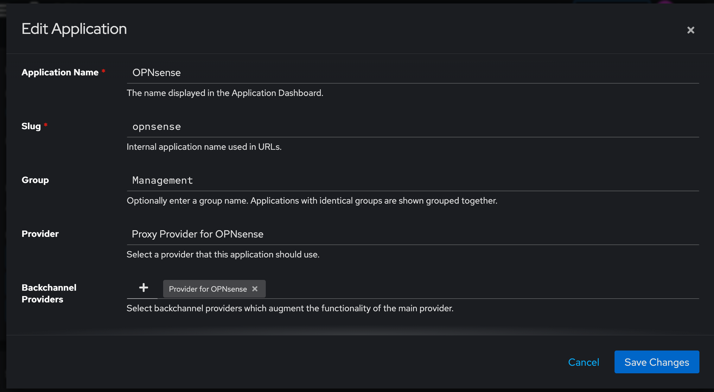

It is noted that OPNsense remains accessible through its IP and VLAN-hostname in the LAN VLAN as per current firewall configuration. Accessing it this way rather than through the Traefik hostname will bypass the `forwardAuth` Proxy authentication screen, but will still allow for LDAP authentication. This is a pending item that will be resolved by tightening the firewall rules such that only the traefik host can access the WebUI, once the system has proven stable, in order to avoid potential lockouts. In the meantime, the current rules already heavily restrict access to the WebUI to trusted VLANs, so there is no inherent increase in risk.

**Jellyfin:**

The previously created `ldapservice` account was used for the bind credentials for Jellyfin. When validating the configuration, the LDAP plugin failed with an `AmbiguousMatchException` error. A quick review of the documentation suggested the root cause was a duplicate plugin, which was proven right by accessing a terminal inside the container and listing the plugin directory. The older plugin was manually deleted, after which the LDAP plugin successfully connected to Authentik. Since Jellyfin supports Admin and user provisioning, the following groups were set up:

```
(memberOf=cn=JellyfinUsers,ou=groups,<BaseDN>)
(memberOf=cn=JellyfinAdmins,ou=groups,<BaseDN>)
```

The plugin speaks LDAP directly to Traefik's LDAPS entrypoint, which goes through a TCP router. Web middlewares do not apply there, so LDAP utilizes the `trusted-ldap` TCP middleware.

#### OIDC

**Home Assistant:**

A self-signed TLS certificate was generated and deployed within Home Assistant to encrypt the local traffic traversing the OVS bridge. The Traefik middleware definition for this route was updated to the new IP address and included a `insecureSkipVerify` block, ensuring end-to-end encryption between the proxy and the VM guest.

Once routing was confirmed, OpenID Connect (OIDC) was enabled in Home Assistant. An application and OIDC provider were created in Authentik, using a confidential client. The redirect uri was configured per HomeAssistant's requirement (`https://homeassistant.{DOMAIN}/auth/oidc/callback`), and user synchronization was enabled. Existing Home Assistant accounts were manually impersonated and bound to their Authentik counterparts, after which user synchronization was disabled, since there is no expectation to create any new HomeAssistant users in the forseable future.

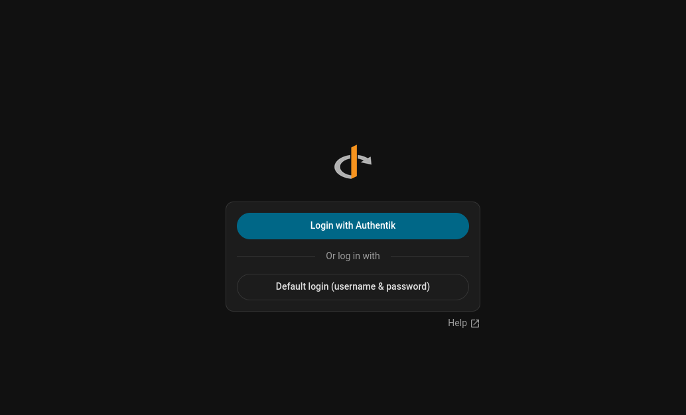

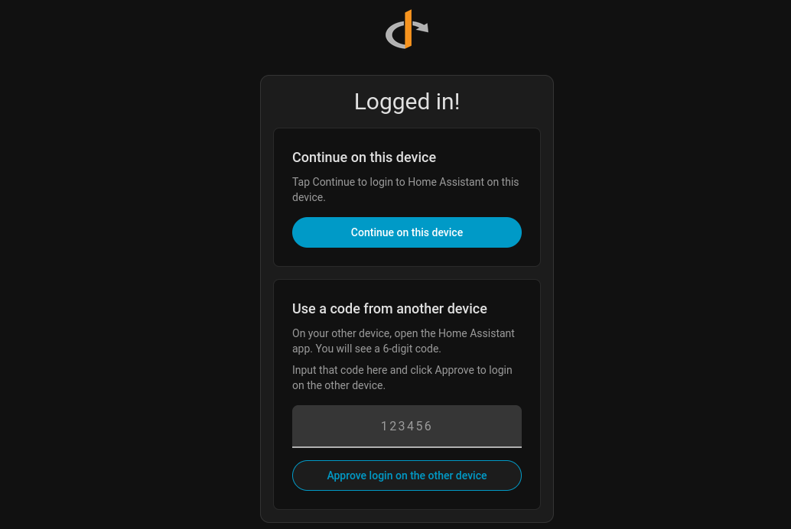

This process has raised the question of whether HomeAssistant needs an external IP at all since the interface access sits behind Traefik. This decision is out of scope, and future revisits need to evaluate the implications of putting it behind NAT and the Traefik proxy, especially when it comes to the eventual migration to local device control, which might require a dedicated interface.

## 4. Outcome & Future Considerations

* **Result:** Authentik is deployed behind Traefik with Let's Encrypt certificates on the web interface.

* **Result:** The LDAP outpost runs in compose, with no Docker socket access anywhere in the Authentik stack, and the worker no longer runs as root.

* **Result:** LDAPS works through TCP passthrough with the full certificate chain. Plain LDAP is closed, and access is limited by VLAN, firewall, and a Traefik TCP allowlist.

* **Result:** Four services use Authentik: Audiobookshelf and Dockhand through OIDC, and Jellyfin and OPNsense through LDAP.

* **Result:** PostgreSQL stays on its own internal network.

* **Result:** MacVTap host-guest isolation resolved permanently. Guest VMs now communicate directly with host services and Authentik over an Open vSwitch trunk without `socat` proxies. This also opens the door for future VLAN additions without extra NICs.

### Next Steps

* [ ] **Pending:** Confirm the first automatic certificate renewal reaches Authentik, and whether the outpost needs a restart to use it.
* [x] **Completed:** Remove `env_file: .env` from the server, worker, and database services, after testing that nothing depends on it. [2026-10-10]
* [ ] **Pending:** Review which Docker API sections Traefik's socket proxy really needs, and turn off the rest.
* [ ] **Pending:** Finalize the migration of all homelab services to Traefik, which is a pre-requisite for Authentik.
* [ ] **Pending:** Write ADR for Authentik Implementation and perform the migration of all homelab services.
* [x] **Completed:** Connect Home Assistant to Authentik. [2026-10-05]
* [x] **Completed:** Define a Traefik `forward-auth` middleware for apps with no native login. [2026-10-10]
* [ ] **Pending:** Configure email settings for alerts and password recovery.
* [ ] **Pending:** Add a note on rotating the LDAP service account password.
* [ ] **Pending:** Review Traefik stability as OPNsense ingress and tighten firewall rules to force `forwardAuth` on all clients reaching the WebUI.
* [x] **Completed:** Remove Docker socket access and root from the Authentik worker. [2026-10-03]
* [x] **Completed:** Close plain LDAP (port 389) and add a TCP allowlist for LDAPS. [2026-10-03]
* [x] **Completed:** Replace MacVTap VM networking with Open vSwitch VLAN trunking to resolve VM-to-host Authentik communication. [2026-10-05]
* [x] **Completed:** Decommission legacy `socat` systemd proxy units from the Traefik host once all VMs are confirmed on OVS. [2026-10-05]

---
