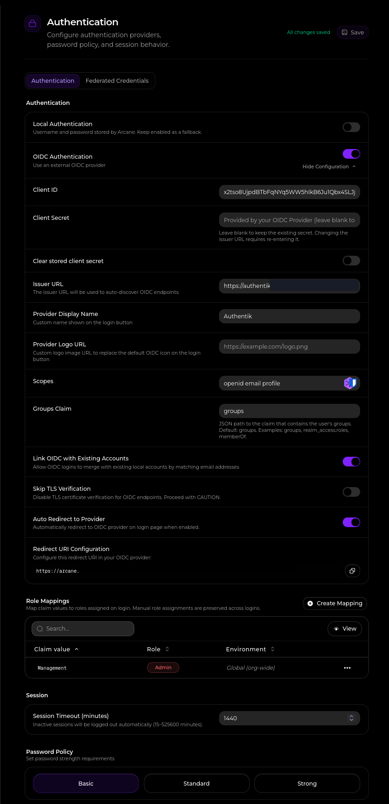
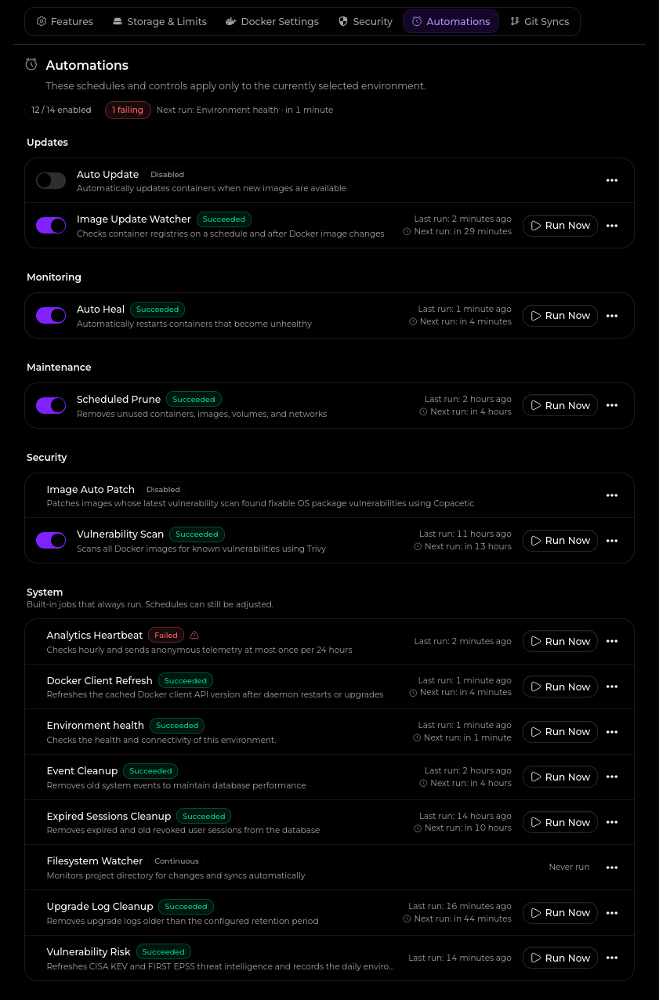

# Sysadmin Log: Arcane Migration

**Date:** 2026-11-12

**Report Time:** 08:16

**Category:** Architecture

**Status:** Completed

---

## 1. Context & Problem Statement

### One-line summary

Replace the existing DockHand container management system with Arcane to establish a fully open-source orchestration layer with native OIDC, RBAC, and CI/CD pipeline integration, while preserving declarative YAML file binding.

### Background

The homelab infrastructure has historically relied on DockHand for container management. While functional, DockHand is source-available (not fully open-source) and restricts critical security features, such as Role-Based Access Control (RBAC), behind an Enterprise license. As the infrastructure evolves to support a formalized CI/CD pipeline (driven by Gitea Actions), the orchestration layer must support programmatic deployments, security scanning, and granular access control via Authentik (OIDC). Furthermore, the chosen orchestrator must rely on direct YAML file bindings rather than an internal database to ensure configuration portability and prevent vendor lock-in.

## 2. Architectural Decisions & Strategy


### Decision 1: Migrate container Orchestration to Arcane

Decommission DockHand and deploy Arcane as the centralized Docker orchestration and management UI to securely manage container state and execute deployments triggered by Gitea Actions.

### Rationale

Arcane offers the exact intersection of features required for the new GitOps control plane. It provides the enterprise security features (OIDC via Authentik and RBAC) that DockHand paywalls, without abandoning the direct `docker-compose.yml` file-binding architecture that ensures our repositories remain the ultimate source of truth. Komodo was rejected due to its database-centric state management and resource overhead, making Arcane the most portable and efficient choice.

## 3. Implementation & Execution

### Phase 1: Stack Deployment and Traefik Integration

The Arcane stack was created, and the docker root was bind-mounted to the container. This allows Arcane to control the compose projects, update them and deploy them.

### Phase 2: OIDC Connection.

OIDC was connected by creating the application and provider in Authentik, then configuring Arcane to authenticate aganist it. AAdmin role mapping was done by mapping against the Management group, and once this was validated, local authentication was disallowed.



### Phase 3: Notifications Integration

Additionally, notifications were configured by creating a Discord Server that Arcane can connect to to send updates. This is helpful for vulnerability scans, deployments and updates.


### Phase 4: Automation Setup

Once notifications were configrued, several automations were enabled: health check, vulnerability assesments, auto pruning and auto-healing. Auto Image Updating is disabled to allow the operator to make decisions on updates. The failure message for the Analytics heartbeat is expected: DNS sinkholing blocks the heartbeat package.



### Phase 5: DockHand Removal

Dockhand was Spun down, and its data was deleted. Realistically, Dockhand is mostly stateless, especially since the it never acted as a deployment platform, only a management plane. The configuration files will remain available in the repository history in case of a rollback.

```bash
cd ${DOCKER_FOLDER}/dockhand
docker compose down
rm -rf ${DOCKER_FOLDER}dockhand
cd ${REPOSITORY_ROOT}
rm -rf docker/observability/dockhand
```

## 4. Outcome & Future Considerations

* **Result:** Arcane is successfully deployed and managing the homelab container stack via direct YAML file bindings.

* **Result:** Enterprise security features (OIDC authentication and Role-Based Access Control) are successfully enforced without requiring a paid license.

* **Result:** Automated maintenance routines (pruning, health-checks) and vulnerability scanning are active and reporting to a centralized Discord webhook.

* **Result:** DockHand is completely decommissioned, removing legacy technical debt. 

### Next Steps
- [ ] **Pending:** Integrate Arcane's CI/CD webhooks into the Gitea Actions pipeline to automate container deployments (Phase 3 of CI/CD rollout).
- [ ] **Pending:** Deploy Infisical to centralize secrets management and complete the GitOps toolchain.
- [x] **Completed:** Finalize ADR-012 and decommission legacy DockHand deployment.
