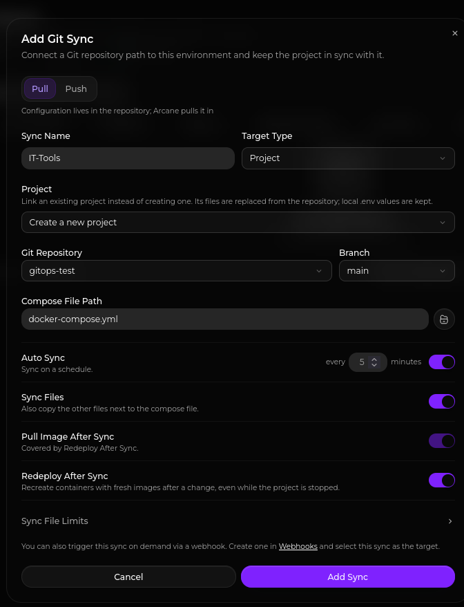
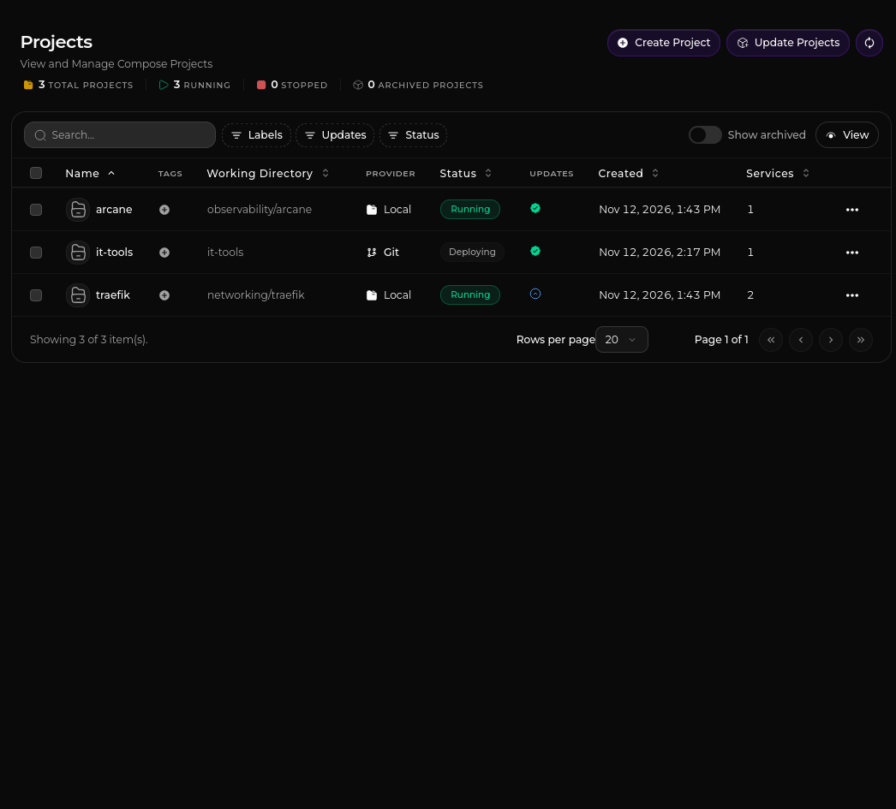
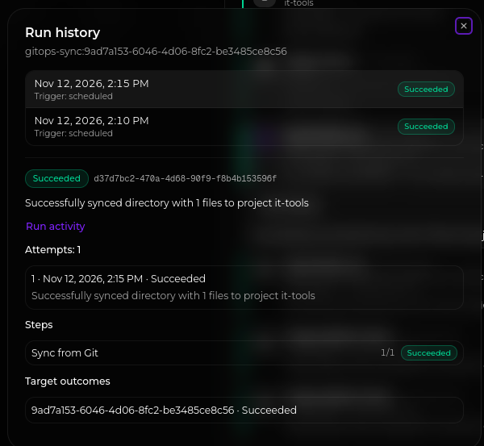

# Sysadmin Log: GitOps Implementation with Arcane and SOPS

**Date:** 2026-11-12

**Report Time:** 16:19

**Category:** Architecture | Security

**Status:** Completed

---

## 1. Context & Problem Statement

**One-line summary:** Establish a pull-based GitOps deployment path in which Arcane pulls Compose projects from Gitea and a pre-deploy lifecycle hook decrypts the repository's SOPS-encrypted `.env` files at deploy time, validated on an isolated test host and then rolled out on the production host, where configuration is first separated from persistent data.

**Background:** Gitea became the primary Git remote and CI/CD control plane on 2026-11-11 ([ADR-011](../adrs/adr-2026-11-11-011-gitea-as-primary-control-plane-and-version-control-system.md)), and Arcane replaced DockHand as the orchestration layer on 2026-11-12 ([ADR-012](../adrs/adr-2026-11-12-012-migration-to-arcane-for-container-orchestration-and-cicd-integration.md)). Deployment itself still meant `rsync` into `/opt/docker` followed by a manual `docker compose up`, with `.env` files synchronized by hand. The missing piece was secrets: a way for plaintext `.env` files to reach the Docker host without ever being committed.

An Infisical deployment was evaluated and rejected the same day (see the [Infisical Deployment log](./2026-11-12-infisical-deployment-for-secrets-managament.md) and [ADR-013](../adrs/adr-2026-11-12-013-infisical-as-secrets-management-solution.md)). It replaced a stateless encrypted file with a stateful vault, and its bootstrap credential still had to sit in plaintext on the host. The decision reverted to SOPS + AGE ([ADR-004](../adrs/adr-2026-04-10-004-implementing-sops-as-the-production-secrets-management.md), amended 2026-11-12).

This log covers the test environment up to the first validated deployment (IT-Tools), the production persistent data migration, and the production GitOps deployment from the `feature/arcane-gitops` branch.

## 2. Architectural Decisions & Strategy

### Decision 1: Pull-based deployment from Gitea through Arcane Git Sync

**Decision:** Arcane pulls each project from Gitea (Git Sync, Pull direction, tracking a branch) and deploys it. Nothing pushes into the Docker host.

**Rationale:**

- The host reaches out to Git, so the pipeline needs no inbound SSH access or deploy credentials on the host. A merge is the deploy, and a rollback is a `git revert`.
- Gitea is the only source of truth. The GitHub mirror is downstream and plays no part in deployment.
- Arcane's synced project directory is a derived artifact. It is never edited by hand, and it does not need to mirror the repository's folder layout.

**Trade-offs accepted:**

- Compose files of Pull projects are read-only in Arcane, so every change must go through a commit.
- Persistent state cannot live inside the synced workspace. It has to move to absolute paths under `/opt/appdata` (see Decision 7 and Phase 7).
- Linking an existing Arcane project to a sync replaces its files from the repository. This is the same overwrite behavior the previous `rsync` deployment had.

### Decision 2: Decrypt SOPS files in an Arcane pre-deploy lifecycle hook

**Decision:** Keep SOPS + AGE (ADR-004) as the secrets mechanism. Arcane's pre-deploy lifecycle hook decrypts each project's `.sops.env` into a `.env` immediately before Compose deploys it.

**Rationale:**

- The repository carries ciphertext only, and no new stateful service is introduced.
- A failed hook (non-zero exit, timeout, or failure to start) stops the deploy. A decryption failure therefore cannot produce a stack that starts without its secrets.

**Trade-offs accepted:**

- The decrypted `.env` persists in the project workspace on the host after the deploy. This is the same exposure as the previous rsync model, where `.env` files already lived in `/opt/docker`.

### Decision 3: Run the hook in an ephemeral, rootless container

**Decision:** The hook runs in a short-lived container that Arcane creates for each sync and removes afterwards. The runner image is a custom `sops-rootless` image, hosted in the Gitea registry (`gitea.${DOMAIN}/tobondev/sops-rootless:latest`), that runs as UID 1000.

**Rationale:**

- The sync settings offer no way to set the container user, so a hook runs as the image's default user. The stock SOPS image runs as root, which could not write the decrypted `.env` into a project workspace owned by UID 1000 (see Phase 5). Setting `USER 1000:1000` in the image fixes this at the source.
- The custom image contains only the `sops` binary on an Alpine base, which makes it significantly smaller than the full SOPS image.

**Trade-offs accepted:**

- The image has to be maintained: the SOPS version is pinned in the Dockerfile and is updated by hand.
- The image is hosted in the Gitea registry, which is itself deployed through this pipeline. Once the image is present on the Docker host, this should only matter when rebuilding from scratch.

### Decision 4: Keep the AGE key on the host and mount it read-only into the hook container only

**Decision:** The AGE private key lives at `/srv/arcane/secrets/age.key`, owned by UID 1000 (the hook container's user, see Decision 3) with mode 400, and labeled for container access. It is attached to the hook container through the sync's extra mounts as read-only. The long-running Arcane container does not mount it. The key is the same one defined in ADR-004, backed up in Bitwarden.

**Rationale:**

- The key stays out of Git and out of Arcane's configuration (a sync stores only a mount path). It is mounted into a container only while a hook is running.
- Ciphertext and key live in separate systems. A compromise of Gitea, which hosts both the repository and the runner image, yields ciphertext only.

**Alternative considered and rejected:** baking the key into the `sops-rootless` image would remove the key file from the host, but it would undo the separation above:

- Gitea stores package layers as plain files in its data storage, not in its database, so the key would sit unencrypted in every layer of the image.
- The key would spread to every Docker image store, the build cache, `docker history`, and Gitea's backups. Rotating it would mean purging every image version instead of replacing one file.
- The registry credential on the Docker host would become equivalent to the key itself.

**Trade-offs accepted:**

- A compromise of the Docker host exposes the key and therefore every secret in the repository. This is accepted because the same host already holds the decrypted `.env` files and the Docker socket, and the Infisical evaluation showed that any bootstrap credential on the host carries the same exposure.
- While AGE keys can in theory be scoped per host, attempting this would add complexity and fragility and require a redesign of `sops-sync.py`. Maintaining a single key is accepted as a trade-off.

### Decision 5: One hook script per project, distributed by the pre-commit hook

**Decision:** Every project directory that contains a `.sops.env` also contains its own copy of the pre-deploy script `sops-decrypt.sh`, next to the Compose file. The work is split between a thin Git hook and the scripts it calls, which are committed under `scripts/utils/sops-sync/`:

- **Pre-commit hook (bash):** the orchestrator. It runs the two Python scripts in order and stages the resulting `.sops.env` and `sops-decrypt.sh` files. It contains no encryption or copy logic.
- `sops-sync.py`: keeps every `.sops.env` in sync with its `.env` and creates it when missing.
- `sops-decrypt.py`: runs after `sops-sync.py`, so a `.sops.env` created in the same commit also receives its script. It copies the master `sops-decrypt.sh` into every directory that contains a `.sops.env` and makes the copy executable. It only scans directories tracked on the current branch.
- `sops-decrypt.sh`: the master pre-deploy script that Arcane runs (see Phase 5).

**Rationale:**

- Arcane only runs a script located inside the synced project directory, and hooks are configured per sync, so a repository-wide hook is not possible. Distributing the copies at commit time removes the manual step of remembering them.
- Keeping the Git hook trivial and the logic in separate scripts separates orchestration from the work, and each script can be run and tested on its own.

**Trade-offs accepted:**

- The script is duplicated across projects, and each sync still needs its own hook settings.
- A failure does not yet reliably block the commit: the hook aborts when either script exits non-zero, but the scripts exit with 0 on handled errors such as a failed decryption. Fixing the scripts is pending (see Next Steps).

### Decision 6: Validate on an isolated test host

**Decision:** Build a disposable second host with its own Arcane instance and a trimmed mirror of the production repository (Arcane, Traefik, IT-Tools), and test the whole pipeline there first.

**Rationale:** Arcane's projects directory is fixed to the Docker root bind-mounted into its container. Testing on the production host would collide with the hand-managed projects there. A separate host can also be rebuilt cleanly between experiments.

### Decision 7: Separate configuration from persistent data on the production host

**Decision:** On the production host, `/opt/docker/{app}` holds configuration only (Compose files and static configuration managed through Git), and everything a service writes at runtime lives in `/opt/appdata/{app}`. Bind mounts are rewritten to absolute paths accordingly.

**Rationale:** Arcane replaces a Git-synced project's files from the repository, so nothing that a service writes at runtime can live inside the project directory. Until now, `/opt/docker/{app}` held both. The classification rule: state written by the service at runtime moves, configuration authored in Git stays, and system paths such as the Docker socket and timezone files are left alone.

**Trade-offs accepted:**

- Every volume mapping had to be classified by hand.
- The copy required a one-time downtime, because Docker was stopped to get a consistent copy of the data.
- The original directories were kept as `.bak` until each service was verified.

### Decision 8: Turn `${DOMAIN}` into Global Environment Variable

**Decision:** Remove the `${DOMAIN}` variable from all `.env` files (except for Arcane's) and replacing it with a global environment variable in Arcane.

**Rationale:** Arcane is able to use Global Environment Variables for all projects in the host. Because the `${DOMAIN}` variable exists precisely to distinguish different host, using a global environment variable allows all containers to resolve their Traefik Domain Name without needing to add it to every single `.env` file. Additionally, this makes deploying on different hosts, including Staging and Development significantly easier: they can deploy from the same repository using their global `${DOMAIN}` variable to the specific value for said host without the need for any further modification.

---

## 3. Implementation & Execution

### Phase 1: Test Host Baseline

The test host was prepared with `/opt/docker` and `/opt/appdata`, both owned by the unprivileged user (UID 1000). A new `gitops-test` repository was created in Gitea, mirroring the production layout but reduced to what the test needs. Only the compose files, config files and the encrypted `.sops.env` files are committed; plaintext `.env` files are listed in `.gitignore`.

```bash
├── .gitignore
├── .sops.yaml
└── docker
    ├── networking
    │   └── traefik
    │       ├── .sops.env
    │       ├── config
    │       │   └── traefik.yml
    │       ├── docker-compose.yml
    │       └── dynamic_conf
    ├── observability
    │   └── arcane
    │       ├── .sops.env
    │       └── docker-compose.yml
    └── tools
        └── it-tools
            └── docker-compose.yml
```

Arcane and Traefik were deployed manually with local `.env` files and committed to Gitea. Arcane has to be bootstrapped by hand, since it cannot pull itself into existence. Traefik's config was trimmed for the test, but its middleware definitions were kept unchanged. IT-Tools was left uncommitted until the Git Sync was ready.

The test host runs SELinux in Enforcing mode, which the production host does not, and it surfaced two incidents during the bring-up:

| Incident | Symptom | Cause | Fix |
| --- | --- | --- | --- |
| 1 | Traefik failed to start: `error adding file watcher for /dynamic_conf: permission denied` | SELinux denied the container access to bind-mounted host directories that carry no container label | Added the `:z` mount option to the Traefik bind mounts |
| 2 | Arcane's UI loaded but reported the local environment as offline; the log showed `permission denied while trying to connect to the docker API at unix:///var/run/docker.sock` | SELinux denied the container access to the Docker socket | Added `security_opt: label=disable` to the Arcane service |

The `:z` option is ignored on hosts without SELinux. `label=disable` removes SELinux confinement from that one container; Arcane already holds the Docker socket (ADR-012, section 9), so the practical exposure is unchanged. After both fixes Traefik routed correctly and Arcane connected to Docker.

### Phase 2: Connecting Arcane to Gitea

A Gitea access token with repository read scope only was created, since a Pull sync never writes. In Arcane, the repository was added under Customization → Git Repositories, using the HTTPS clone URL and the HTTP (Username/Token) authentication type.

```text
URL:  https://gitea.${DOMAIN}/tobondev/gitops-test.git
Auth: HTTP (Username/Token)
```

Arcane's connection test succeeded.

### Phase 3: Git Sync Without Secrets (IT-Tools)

Before adding any secrets, the plain path (Gitea to Arcane to Docker) was tested alone. IT-Tools has no secrets, which makes it a clean first test: if it deploys, the Git-to-Arcane-to-Docker path works.

The Git Sync was created as a Pull sync with these settings:

| Setting | Value |
| --- | --- |
| Target Type | Project (new project) |
| Repository | `gitops-test`, main branch |
| Compose File Path | `docker/tools/it-tools/docker-compose.yml` |
| Sync Files | On (required for hooks later) |
| Auto Sync | On, interval: 5min |
| Redeploy After Sync | On |



The project was created and deployed by Arcane, and the first commit deployed successfully.


The project list shows `it-tools` with the Git provider. Because its files come from the repository, it is read-only in Arcane.



Two behaviors worth recording:

- The project name comes from the Sync Name, not the folder name. The sync was first named `IT-Tools`, so the project was created as `IT-Tools` while the folder is `it-tools`. Renaming the sync changed the project name on the next redeploy.

- The synced project does not reproduce the repository's folder nesting. The nested repository path (`docker/tools/it-tools/`) is only where Arcane reads from, and the project was created in a flat `it-tools` working directory. The production host follows the same convention: `/opt/docker` has never been nested, and only the repository is.

### Phase 4: Host Key Provisioning

The AGE private key was placed on the Docker host in a restricted directory, with a persistent SELinux label so it survives a filesystem relabel.

```bash
sudo mkdir -p /srv/arcane/secrets
install -m 600 -o 1000 -g 1000 /dev/null /srv/arcane/secrets/age.key
nano /srv/arcane/secrets/age.key
chmod 400 /srv/arcane/secrets/age.key
sudo semanage fcontext -a -t container_file_t "/srv/arcane/secrets(/.*)?"
sudo restorecon -Rv /srv/arcane/secrets
ls -ldZ /srv/arcane/secrets
```

### Phase 5: Pre-Deploy Hook

Arcane's documentation sets these constraints: hooks must be enabled by an admin, the sync must be a Pull sync targeting a project, Sync Files must be on so the script is copied with the Compose file, and the script path must point to a file inside the synced project directory.

**Enabling hooks:** Under Environments → Security → Lifecycle Hooks, hooks were enabled by an admin, with `gitea.${DOMAIN}/tobondev/sops-rootless:latest` as the default runner image and a maximum timeout of 300 seconds.


**The runner image:** The initial test showed that the stock SOPS image cannot serve as the hook runner:

| Incident | Symptom | Cause | Fix |
| --- | --- | --- | --- |
| 3 | `install: cannot create regular file '.env': Permission denied` when writing `.env` inside project workspace owned by UID 1000 | Arcane starts the hook container as the image's default user (`root` in stock image) and offers no per-sync user setting. Root could not create or modify files in workspaces owned by UID 1000 | Built a custom image that runs as `USER 1000:1000` |

The custom image copies only the `sops` binary from the official Alpine-based SOPS image onto a minimal Alpine base, sets `SOPS_AGE_KEY_FILE`, and drops to UID 1000. It is significantly smaller than the full SOPS image (~15 MB vs ~56 MB).

```dockerfile
FROM ghcr.io/getsops/sops:v3.13.3-alpine AS sops-bin

FROM alpine:latest
COPY --from=sops-bin /usr/local/bin/sops /usr/local/bin/sops
ENV SOPS_AGE_KEY_FILE=/tmp/age.key
USER 1000:1000
```

The image is built from `docker/container-registry/sops-runner/Dockerfile` and published to the Gitea container registry (`docker build -t gitea.${DOMAIN}/tobondev/sops-rootless:latest docker/container-registry/sops-runner/` and `docker push gitea.${DOMAIN}/tobondev/sops-rootless:latest`). The Docker host authenticates to Gitea's registry using a package-scoped Gitea access token stored via `docker login gitea.${DOMAIN}`, allowing Arcane to pull the runner image seamlessly via the host Docker socket.

**Sync hook settings:**

| Setting | Value |
| --- | --- |
| Script path | `sops-decrypt.sh` (next to the Compose file) |
| Runner image | `gitea.${DOMAIN}/tobondev/sops-rootless:latest` |
| Network | `none` |
| Extra mounts | `/srv/arcane/secrets/age.key:/tmp/age.key:ro` |
| Timeout | 60 seconds |

`SOPS_AGE_KEY_FILE` is set in the image, so the sync needs no environment variables.


**The script:** `sops-decrypt.sh` sits next to the Compose file and runs inside the ephemeral container with the project workspace mounted. It first creates an empty `.env` with mode 600, so the secrets are never written to a file with wider permissions, then decrypts `.sops.env` into it using the key file named by `SOPS_AGE_KEY_FILE`, which points at the mounted key:

```sh
#!/bin/sh
set -eu ; install -m 600 /dev/null .env ; sops -d .sops.env > .env
```

**Commit-time distribution:** The pre-commit hook calls both scripts and stages their output:

```bash
#!/bin/bash

echo "Running .env SOPS sync..."

# Run the Python sync script
python3 scripts/utils/sops-sync/sops-sync.py
# If the Python script crashes or fails, abort the commit
if [ $? -ne 0 ]; then
    echo "Error: SOPS sync failed. Commit aborted."
    exit 1
fi
python3 scripts/utils/sops-sync/sops-decrypt.py
# If the Python script crashes or fails, abort the commit
if [ $? -ne 0 ]; then
    echo "Error: SOPS Decrypt Script Sync Failed. Commit aborted."
    exit 1
fi

# Stage any newly created or updated .sops.env files
# so they are included in the commit that is about to happen
git add "**/.sops.env"
git add "**/sops-decrypt.sh"
exit 0
```

On every commit, `sops-sync.py` runs first and keeps each `.sops.env` current, and `sops-decrypt.py` runs second and places a copy of `sops-decrypt.sh` next to every `.sops.env`. The hook then stages both kinds of file. A project with encrypted secrets therefore receives its hook script in the same commit. The hook aborts the commit if either script exits non-zero. The scripts themselves still exit with 0 on handled errors such as a failed decryption, so at present only a crash blocks the commit (see Next Steps).

### Phase 6: Validation

The test ran with the custom runner image from Phase 5. The `DOMAIN` variable used by IT-Tools' Traefik routing was moved into a new `.env`, encrypted into `docker/tools/it-tools/.sops.env`, and pushed to the `gitops-test` repository in Gitea. An operator error on the first secrets commit left the `.env` unsaved, so the commit carried no `.sops.env`. The hook failed on the missing file and the deployment stopped. After the correction was pushed, Arcane pulled the change and ran the pre-deploy hook, which decrypted the file into `.env` before Compose redeployed the project. The run history recorded the trigger as scheduled and the result as succeeded. The result was validated by reaching IT-Tools through its Traefik URL.



### Phase 7: Docker Volume Migration (Production)

Production keeps every project directly under `/opt/docker/{app}`. The nesting (for example `docker/networking/traefik` and `docker/cloud/immich`) exists only in the repository. Since a Git-synced project must not hold runtime state (Decision 7), every volume mapping in every Compose project had to be classified before any data could move.

**Audit:** A bash script collected every bind mount:

```bash
#!/bin/bash
CURRENT_DATE=$(date +"%m_%d_%Y--%H-%M-%S")
OUTPUT="/tmp/volume_audit-${CURRENT_DATE}.csv"
echo "Service_Dir,Volume_Path" > "$OUTPUT"

for dir in /opt/docker/*/; do
    if [ -e "${dir}docker-compose.yml" ] || [ -e "${dir}compose.yml" ]; then
        cd "$dir" || continue
        docker compose config --format json 2>/dev/null | \
        jq -r '.services[].volumes[]? | select(.type == "bind") | .source' | \
        sort -u | while read -r source_path; do
            echo "${dir},${source_path}" >> "$OUTPUT"
        done
    fi
done

echo "Audit saved to $OUTPUT"
```

The script visits each directory under `/opt/docker` that contains a `docker-compose.yml` or `compose.yml`. It asks `docker compose config` for the fully resolved configuration, which turns relative bind mounts into absolute paths, and uses `jq` to keep only the bind-type volumes. The results are written to a timestamped CSV in `/tmp`.

**Classification:** The CSV was opened in a table editor and given an `Action` column. `move` marks state written by the service at runtime (databases, application data, generated configuration). `keep` marks configuration that stays in Git and system paths such as the Docker socket and timezone files.

| Service_Dir | Volume_Path | Action |
| --- | --- | --- |
| /opt/docker/arcane/ | /opt/docker | keep |
| /opt/docker/arcane/ | /var/run/docker.sock | keep |
| /opt/docker/authentik/ | /opt/docker/authentik/custom-templates | move |
| /opt/docker/authentik/ | /opt/docker/authentik/data | move |
| /opt/docker/authentik/ | /opt/docker/authentik/database | move |
| /opt/docker/gitea-runner/ | /opt/docker/gitea-runner/data | move |
| /opt/docker/gitea-runner/ | /var/run/docker.sock | keep |
| /opt/docker/gitea/ | /etc/localtime | keep |
| /opt/docker/gitea/ | /etc/timezone | keep |
| /opt/docker/gitea/ | /opt/docker/gitea/config | move |
| /opt/docker/gitea/ | /opt/docker/gitea/data | move |
| /opt/docker/gitea/ | /opt/docker/gitea/postgres | move |
| ... | ... | ... |

**Extraction:** The edited table was exported as a CSV, and `awk` extracted the paths marked `move`:

```bash
#!/bin/bash
awk -F',' '$3 == "\"move\"" {print $2}' /tmp/volumes_to_be_moved.csv | tr -d '"' | tee /tmp/filtered_paths
```

The resulting list was checked manually against the table to verify that every item was present.

**Migration:** All containers and the Docker service were then stopped, so that the data would be copied in a consistent state:

```bash
docker stop $(docker ps -q) ; sudo systemctl stop docker.service docker.socket
```

The migration script creates each destination under `/opt/appdata`, sets its owner to the unprivileged user, copies the data with `rsync`, and renames the original to `.bak` only when the copy succeeded. A failed copy leaves the original in place:

```bash
#!/bin/bash

LIST_FILE="/tmp/filtered_paths"
mkdir /opt/appdata
while read -r src; do
  # Skip any blank lines in the text file
  [ -z "$src" ] && continue

  if [ -d "$src" ]; then
    appdata_dest="${src/\/opt\/docker/\/opt\/appdata}"
    echo "Syncing: $src -> $appdata_dest"
    mkdir -p "$appdata_dest"
    chown 1000:1000 "$appdata_dest"
    rsync -a "$src/" "$appdata_dest/"
    if [ $? -eq 0 ]; then
      echo "Sync successful. Renaming original to .bak..."
      mv "$src" "${src}.bak"
    else
      echo "ERROR syncing $src. Leaving original directory intact."
    fi
  else
    echo "Skipping: Directory not found ($src)"
  fi
done < "$LIST_FILE"
echo "Migration sync complete."
```

**Restart and verification:** The script ran without errors. Every container was then started again with its volume mappings pointing at the new paths, beginning with Arcane, and each service was verified manually in addition to its health status in Arcane. After validation, the `.bak` directories were removed manually.

**Repository update:** The volume mappings are defined in each project's `.env`, so the matching `.env` files in the `homelab` repository were updated by hand, since the repository's nested layout differs from the flat layout on the host. The Compose changes were made on the `feature/arcane-gitops` branch, which becomes the production deployment branch.

Additionally, following Decision 8, all domain mentions need to be erased from the `.env` files. This is done by using find and sed.

```bash
find ./docker -type f -name ".env" -exec sed -i 's/DOMAIN=${DOMAIN}//g' '{}' \;
```

The commit hook validated the result. Committing the updated `.env` files triggered the pre-commit hook, which ran `sops-sync.py` to re-encrypt each one into its `.sops.env` and staged the changes. The commit was aborted by leaving the message empty, and `git status` confirmed the changed files:

```bash
modified:   docker/authentik/.sops.env
modified:   docker/cloud/immich/.sops.env
modified:   docker/cloud/nextcloud/.sops.env
modified:   docker/gitea-runner/.sops.env
modified:   docker/gitea/.sops.env
modified:   docker/networking/traefik/.sops.env
modified:   docker/observability/arcane/.sops.env
modified:   docker/tools/it-tools/.sops.env
modified:   docker/web/tobon.dev/.sops.env
```

The global environment variable was then created Arcane and assigned to all containers in the local host.


Post commit, examining the IT-Tools project shows no environment file present at all, with the traefik URL calling upon the `${DOMAIN}` variable.


Despite the lack of environment file, inspecting the container confirms that the `${DOMAIN}` variable was injected by Arcane.


The container was also confirmed reachable at its URL.

### Phase 8: GitOps Deployment (Production)

With the persistent data under `/opt/appdata`, the production Arcane instance was connected to the `homelab` repository, and every project was moved onto a Git Sync tracking the `feature/arcane-gitops` branch.

**Preparation:** The pieces proven on the test host were repeated on production: a read-only Gitea access token with the repository added under Customization → Git Repositories (Phase 2), the AGE key provisioned on the host (Phase 4), and lifecycle hooks enabled with the `sops-rootless` runner image (Phase 5).

**Syncs:** Each project was added by hand, working through the list of services in the repository until all were deployed. Every sync uses the same settings as in Phase 3 (Pull, target Project, Sync Files on, Auto Sync every 5 minutes, Redeploy After Sync on), apart from the Compose file path. Every project also has the pre-deploy hook from Phase 5. The pre-commit hook had already placed `sops-decrypt.sh` next to every `.sops.env`, so each sync only needed the hook settings. Existing Local projects were linked to their syncs, so Arcane replaced their files from the repository, the same behavior as the previous `rsync` deployment.


**Order:** Gitea was deployed last, because the other syncs and the runner image potentially depend on it. Nothing notable happened during its deployment.

**Arcane itself:** Arcane cannot manage its own project through a Git Sync. Its documentation says so, and the interface warns when a sync is added for it. It therefore remains a Local project in `/opt/docker/arcane`, deployed by hand. Arcane can update itself, so only changes to its own Compose configuration need a manual deployment. In the future, two Arcane instances could connect to each other and manage one another, but production has a single instance, so this does not apply today.

**Branch:** The syncs keep tracking `feature/arcane-gitops` and not `main`. A change can therefore be deployed and tested on production before it is merged into `main`.

**Validation:** Every project was redeployed from Git, one at a time. All of them came up healthy in Arcane and were functional.


Some noted exceptions on projects that remain local are Wazuh and personal deployments that will be handled by a different repository. 


### Phase 9: Production Updates

During this deployment, repository tracking was added to existing deployments that didn't have so before, or were tracked in a different repository, like Vaultwarden (`docker/cloud/vaultwarden`). Newly introduced and restructured services were onboarded into the GitOps workflow:

* **SeaweedFS** (`docker/cloud/seaweedfs`): Added S3-compatible distributed storage stack (Master, Volume, Filer, S3 Gateway, WebDAV) with SOPS-encrypted `s3.sops.json` configuration.
* **Vaultwarden** (`docker/cloud/vaultwarden`): Onboarded to GitOps with `.sops.env` secret decryption.
* **MeshCentral** (`docker/tools/meshcentral`): Integrated into Git-managed stacks.
* **Cloudflare Tunnel** (`docker/web/cloudflare`): Standardized under the web service directory.
* **Gitea Service Separation**: Split Gitea Server (`docker/git/gitea`) and Gitea Act Runner (`docker/git/gitea-runner`) into separate project directories.
* **IT-Tools Image Update**: Replaced abandoned original image with `ghcr.io/sharevb/it-tools:latest` to provide modern developer and container conversion utilities.

---

## 4. Outcome & Future Considerations

* **Result:** The pull-based path is validated end to end on the test host: a commit to Gitea is pulled by Arcane, deployed, and redeployed automatically after a correction, with no access into the Docker host.

* **Result:** SOPS decryption works inside Arcane's pre-deploy hook. The repository holds ciphertext only, and the AGE key exists only on the host and, while a hook runs, inside a read-only mount in an ephemeral container.

* **Result:** The pre-commit hook creates and stages a copy of `sops-decrypt.sh` next to every `.sops.env`. A handled error in either script does not yet block the commit.

* **Result:** The test host exposed SELinux behavior that the production host does not have. The fixes are documented in Phase 1.

* **Result:** The stock SOPS image could not serve as the hook runner. A custom rootless image fixed the permission problem and is significantly smaller (~15 MB vs ~56 MB).

* **Result:** The production host was prepared for the rollout. Persistent data lives under `/opt/appdata`, every service was verified after the move, and the `feature/arcane-gitops` branch holds the matching configuration.

* **Result:** The production stack now runs as code. Every project is deployed by a Git Sync tracking `feature/arcane-gitops`, secrets are decrypted at deploy time by the pre-deploy hook, and persistent data lives outside the synced workspace.

### Next Steps

* [x] **Completed:** Deploy Arcane and Traefik on the isolated test host. [2026-11-12]
* [x] **Completed:** Connect Arcane to Gitea and validate a plain Git Sync with automatic redeploy (IT-Tools). [2026-11-12]
* [x] **Completed:** Provision the AGE key on the host and validate the SOPS pre-deploy hook. [2026-11-12]
* [x] **Completed:** Build the `sops-rootless` runner image and publish it to the Gitea registry. [2026-11-12]
* [x] **Completed:** Create `sops-decrypt.py`, which ensures every project has a copy of `sops-decrypt.sh`. [2026-11-12]
* [x] **Completed:** Chain `sops-decrypt.py` after `sops-sync.py` in the pre-commit hook. [2026-11-14]
* [x] **Completed:** Check the exit status of each script in the pre-commit hook, so that a crash in either aborts the commit. [2026-11-14]
* [x] **Completed:** Separate `/opt/docker` (configuration) from `/opt/appdata` (persistent data) on the production host. [2026-11-13]
* [x] **Completed:** Create the `feature/arcane-gitops` branch with the Compose projects updated for the new layout. [2026-11-14]
* [ ] **Pending:** Make `sops-sync.py` and `sops-decrypt.py` exit non-zero on handled errors, so that a failure blocks the commit.
* [x] **Completed:** Apply the Git Sync and hook configuration to the remaining Compose projects, linking each existing Local project to its sync. Arcane replaces the project's files from the repository, as `rsync` did before. [2026-11-14]
* [x] **Completed:** Production rollout: provision the AGE key and enable lifecycle hooks on the production Arcane instance. [2026-11-14]
* [x] **Completed:** Production rollout: merge `feature/arcane-gitops`, redeploying the stack automatically via GitOps. [2026-11-16]
* [ ] **Pending:** Build an automated patching and redeployment pipeline that leverages Arcane's image scanning and patching feature.
